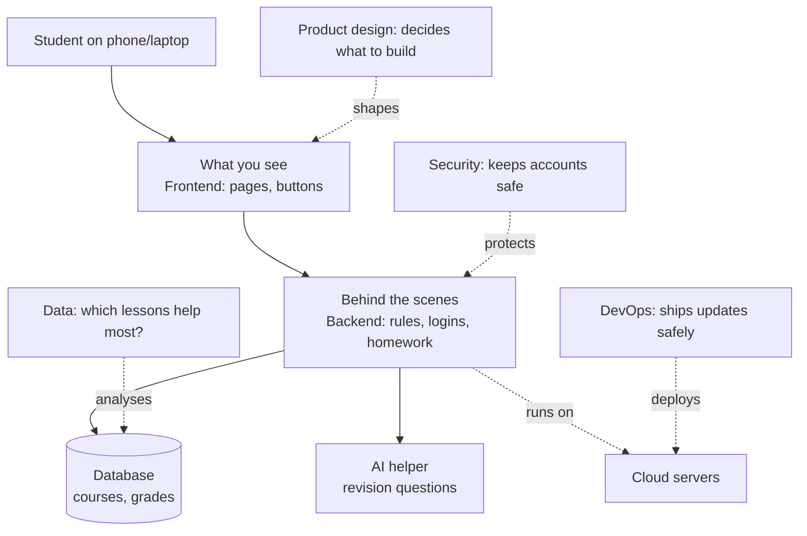

# D1 — Anatomy of an app (W01-ALL-LO1, W01-ALL-LO2)

No code. Use a whiteboard (or the Mermaid diagram below on screen). The app: **"StudyHub" — an invented school learning platform** (students see courses, submit homework, get AI revision help). It is the same kind of system the capstone builds in Week 16, so name it and come back to it.

## Script
1. **Ask:** "What can you DO in a learning app?" Write answers as features (log in, see homework, upload work…).
2. **Ask for each feature:** "What has to happen behind the scenes?" Draw boxes as answers come.
3. **Reveal roles:** label each box with the role that builds or looks after it (frontend, backend, data, AI, cloud, DevOps, security, product design).
4. **Land the point:** "Writing code is one part. Engineers also decide what to build, design it, test it, keep it safe, ship it and fix it. That's software *engineering*."
5. **CL extension (2 min):** add "QA/testing", "SRE/on-call", and "Product Manager" and ask who talks to whom when a bug is reported.
