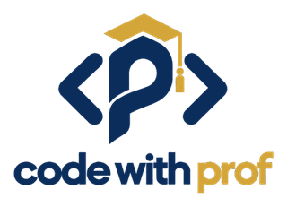

# CodeWithProf - NextGen Web, Cloud & AI Engineering Bootcamp - (Explorers) Cohort 1

This repository holds the **Explorer** track for ages **9–14** in a 16-week cohort. Each week has its own folder so students and instructors can find the reading, slides, activities, and demos from one entry point.

**Owner:** Salvaton Lloyd Stanley-Kemuel

## Weeks

| Week | Topic | Materials |
| --- | --- | --- |
| 01 | Welcome to technology and how the internet works | [Open Week 01](Explorer/Week%2001/README.md) |
| 02–16 | Added as the cohort progresses | Links will appear when the week folders exist |

Start with the [Explorer track](Explorer/README.md) for the learning path. Week 01 introduces software engineering, technology roles, DNS, URLs, HTTP, APIs, cloud computing, and safe use of AI. It uses a fictional learning site called StudyHub throughout.

## Adding a week

Create `Explorer/Week NN/README.md` with links to every file in that week, then add one row to the table above. Keep links relative to the Markdown file. Add a short run or use instruction beside every demo. Only link to files that are present in the repository.
